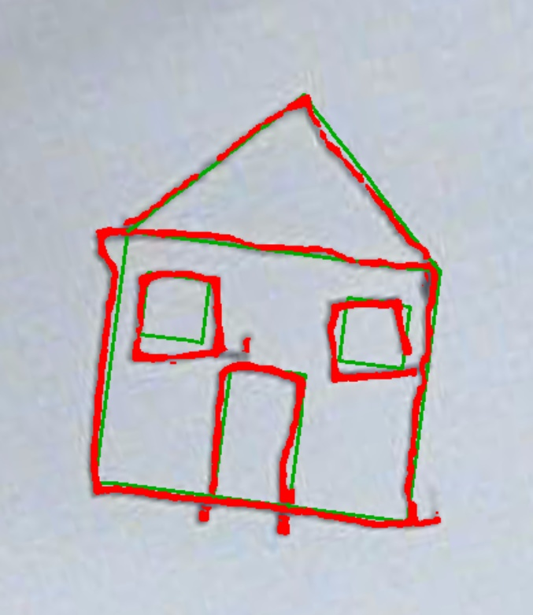

# RobTop

**A robot arm for your desk that takes on whatever you put in front of it: it draws, plays you at tic-tac-toe, and beats Geometry Dash levels.**

[](https://hackumass.com)
[](https://github.com/TheRobotStudio/SO-ARM100)
[](#quick-start)

**[Results](#results)** · [How it works](#how-it-works) · [Hardware](#hardware) · [Quick start](#quick-start) · [What we built](#what-we-built-at-the-hackathon--what-we-did-not-build)

Robot arms that can do many different jobs usually sit in labs and cost thousands of dollars. The ones you can print at home tend to do one trick.

RobTop (short for Robot Tabletop) is one cheap arm on a table, with a webcam above it, that we keep handing new jobs. Give it a pen and it draws. Draw an X and it plays you at tic-tac-toe. Give it a key to press and it plays a video game where one late press ends the run. Take the second arm in your hand and it follows you.

The arm is the open-source [SO-101](https://github.com/TheRobotStudio/SO-ARM100). We 3D printed the parts, assembled both arms and wrote the software at HackUMass XIV, November 13 to 15, 2026.



What the webcam sees after RobTop draws a house: the plan in green, the ink in red.

## Results

Everything below ran on the real arm unless it says otherwise.

| | Result | Source |
|---|---|---|
| Drawing a house | **97.6% of the planned line has ink within 2 mm.** The ink sits 1.0 to 1.2 mm from the plan on average, after ten rounds of camera correction. The photo is lined up with the plan before scoring, so this measures the shape, not where it sits on the page. | `docs/arm-session-2026-11-14.md` |
| Drawing a flower | **9 of 9 strokes drawn**, 0.99 mm from the plan on average. The quick version takes **50 s**. | same |
| Small circles | 14 mm circles came out 8.5 to 39% out of round. With a run-in before the pen lands: **5.7 to 12.5%**. | same |
| Tic-tac-toe | **4 full games against a person, 4 won by the arm.** One earlier game was stopped when it drew an O on top of an X. We changed it to follow the grid it had drawn, and the three games since were clean. In simulation: 400 games, 0 lost. | same, section 7 |
| Geometry Dash | **Stereo Madness cleared 3 times** on Saturday night (11:37, 11:46 and 11:51 PM), with six failed runs among the attempts. | same |
| Key timing | Presses go out **105 ms early** and releases 116 ms early. Both are measured on the arm. | `poses/` on `daniel/arm-core` |
| A second level | A 47 s recording of God Yeeter: **67 presses, no deaths**, in one run. | `docs/arm-session-2026-11-14.md`, section 7 |
| Gestures | **6 of 11** have run on the real arm from the keypad: dance, victory, nod, shake, fist bump and hi. The other five have only run in the simulator. | same, section 7 |
| Shake filter | Ran once with a real hand. **No figure was measured on the arm, so we don't claim one.** On synthetic input it removes 90% of a 6 Hz shake. | `tests/test_steady.py` on `daniel/arm-core` |

The session record is on the `daniel/arm-core` branch until that branch is merged.

## How it works

1. **Show.** Before a job, we place the arm by hand on what it will work with: the corners of the paper, the top of the key. RobTop saves those joint angles and blends between them to reach any point in between.
2. **Plan.** A drawing is a list of strokes in millimetres. A Geometry Dash level is a list of key presses in milliseconds. A tic-tac-toe reply comes from searching every possible game.
3. **Lead.** Hobby servos have slack and lag. The pen starts each stroke 3 to 4.5 mm early and runs in along the stroke's direction before it touches the paper. Each key press is sent about 105 ms before it is due.
4. **Look.** The webcam photographs the page. OpenCV finds the sheet's four corners, flattens the photo to millimetres, and compares the ink with the plan. That scores a drawing and corrects the next attempt. In tic-tac-toe it finds the X a person just drew.

RobTop does not watch the Geometry Dash screen. The level never changes, so the hard part is pressing on time with a cheap arm, and that is the part we measured.

The second arm is a copy of the first that a person holds. RobTop reads its joints 30 times a second and follows, adding a fixed offset per joint because the two arms were calibrated differently. A low-pass filter can be switched on to smooth out a shaky hand.

One program, the dispatcher, owns the arm and runs one move at a time. The keypad, the Geometry Dash player and typed requests all reach it over a local socket. For a typed request such as "wave at me", Claude reads a one-line description of each move and picks one. The model only chooses. The motion is always one we taught the arm.

## Hardware

| Part | What it does here |
|---|---|
| SO-101 follower arm, 3D printed, six Feetech STS3215 servos | Does the work |
| SO-101 leader arm, 3D printed, six Feetech STS3215 servos | The arm a person holds |
| USB webcam, 1080p, above the table | Reads the paper for drawing and tic-tac-toe |
| SayoDevice O3C three-key pad | The Geometry Dash key, and the buttons that set off gestures |
| Sharpie wrapped in duct tape | The pen. The claw was strong enough, but the bare marker was too thin to hold |
| Windows laptop with WSL | Runs everything |

RobTop lifts light things only: a marker, a Cheeto, a Duplo brick.

## Quick start

You need Python 3.12 and `uv`. These steps run in the simulator, so they need no arm and no API keys.

```bash
git clone https://github.com/eddyzow/helping-hand.git
cd helping-hand
uv venv && uv pip install -r requirements.txt
.venv/bin/python keypad/geometry_dash/fetch_so101_model.py   # download the arm's simulator model, once
.venv/bin/python sim_draw.py cat                             # the simulated arm draws a cat
.venv/bin/python -m tests.test_core                          # prints "core ok"
```

On the real arm, with [LeRobot](https://github.com/huggingface/lerobot) installed and both arms calibrated:

```bash
source demo/cmds.sh    # one-word commands; change the two paths at the top to yours
ttt                    # tic-tac-toe against a person
flower                 # or: house
dispatcher             # owns the arm; Geometry Dash and the pad gestures need it
gd                     # Geometry Dash, with `keypad` running in another terminal
```

The real-arm scripts (`demo/`, `teleop_sync.py`, `steady.py`) are on the `daniel/arm-core` branch until it is merged.

Other entry points:

- Second arm: `python teleop_sync.py`. Run it with `--measure` once to line the two arms up.
- A typed request: `python voice/route.py "wave at me"`, with `ANTHROPIC_API_KEY` in `.env`.
- More of the simulator: `python sim.py --skill wave`.

Only one program can hold the arm's serial port at a time, so stop one before starting the next.

## Architecture

| Folder | Owner | What's in it |
|---|---|---|
| `core/` | Daniel | The dispatcher (`127.0.0.1:8765`: `run`, `stop`, `home`, `status`, `list`) and the arm wrapper, with a mock arm for tests |
| `demo/` | Daniel | The drawing loop, tic-tac-toe, the webcam code and the one-word demo commands |
| `skills/` | shared | One file per move, each with a `NAME`, a `DESCRIPTION`, `PARAMS` and `run(arm, params, stop)` |
| `keypad/` | Jonathan | The pad listener, the Geometry Dash recordings and player, and a simulated keypad for testing timing |
| `voice/` | Eddy | Turns a typed or spoken sentence into a move |
| `sim.py`, `sim_draw.py` | Eddy | The MuJoCo simulator for moves and for drawing |
| `skills/personality.py` | Ben | The nod, shake, celebrate and dance moves |
| `docs/` | Daniel | The record of what ran on the real arm, with photos |
| `tests/` | shared | Run each with `python -m tests.<name>` |
| `video/` | Eddy | The demo video, built with Remotion |

## Built on

| Project | What it does here |
|---|---|
| [SO-101](https://github.com/TheRobotStudio/SO-ARM100) by TheRobotStudio | The arm's mechanical design |
| [LeRobot](https://github.com/huggingface/lerobot) by Hugging Face | Motor drivers, calibration and reading the second arm |
| [MuJoCo](https://mujoco.org) and [MuJoCo Menagerie](https://github.com/google-deepmind/mujoco_menagerie) | The simulator and its model of the SO-101 |
| OpenCV | Finding the paper and the ink in the webcam photo |
| Claude (Anthropic API) | Picks a move from a typed sentence |
| OpenAI API | Speech to text |
| Hershey Fonts and Google's Quick, Draw! | Stroke data for writing and sketches in the simulator |

## What we built at the hackathon & what we did not build

Built at HackUMass XIV, November 13 to 15, 2026: both arms, 3D printed and assembled at the event, and the code in `core/`, `skills/`, `demo/`, `keypad/`, `voice/`, `tests/`, `video/` and the scripts at the top of the repo. We wrote it with AI coding agents, Claude Code among them.

What we did not build:

- **The arm's design.** SO-101 is by TheRobotStudio. We printed, assembled and calibrated it.
- **Motor drivers and calibration.** Those are LeRobot's.
- **The simulator models.** The SO-101 model comes from MuJoCo Menagerie, and the keypad's 3D model from SayoDevice Visualizer (MIT, see `keypad/geometry_dash/sayodevice_o3c/LICENSE`).
- **Geometry Dash** is by RobTop Games. Our name is a nod to it, and we are not affiliated with RobTop Games.
- **Prior work, made before the event:** the event clock `.hackathon/hackclock.py`.

## Contributing

Each of us works with a coding agent that follows `AGENTS.md`. Run `git pull --rebase` before every push, and never force-push `main`.
