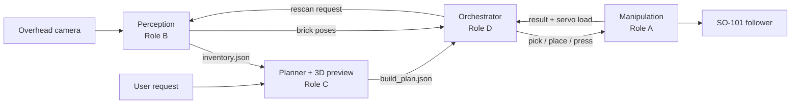

# Helping Hand

An SO-101 robot arm that builds small LEGO Duplo models on its own. A camera works out which bricks are on the table, an LLM proposes builds that use only those bricks, you pick one from a 3D preview, and the arm builds it brick by brick, checking each brick is seated and retrying if it is loose.

> **Fill in before sharing:** submission deadline `____`, and the names for Roles B, C and D below.

---

## 1. The demo we are aiming for

1. Someone dumps a handful of Duplo bricks on the mat.
2. The screen shows the detected inventory ("3 red 2x2, 2 yellow 2x4, ...").
3. The user types or says "build me a tower" (or giraffe, stairs, bridge).
4. The screen shows 2 or 3 candidate builds in 3D. The user picks one.
5. The arm picks each brick, places it, presses it down, and checks it is firm. If it is loose, it presses again.
6. The finished model matches the 3D preview.

Total run time target: under 3 minutes for a 6-brick build.

## 2. Scope

**In scope (MVP)**
- Plain 2x2 and 2x4 Duplo bricks only.
- Builds of 6 to 10 bricks, on a baseplate that is taped or clamped to the table.
- One follower arm doing the building.
- One overhead camera.

**Stretch goals, in priority order**
1. Retry loop that recovers from a dropped or misplaced brick by rescanning.
2. Voice input for the build request.
3. Second arm holding the structure steady while the first presses.
4. Disassembly (one arm clamps, one twists the top brick off).
5. A learned policy (ACT) for the place-and-press skill, trained from teleop demos.

**Out of scope**
- Special pieces: the car, window, figures, roof, flower, bread, numbered bricks. Perception should detect and ignore them.
- Standard small LEGO. Everything here is Duplo.
- SmolVLA or OpenVLA for recognition. Classic computer vision is enough because the bricks are single solid colours on a black mat.

## 3. The one test that decides everything

**Go / no-go press test (do this before anything else, about 30 minutes, owner: Role A).**
Teleoperate the follower with the leader and try to press a 2x2 brick firmly onto a 2x4. Try it close to the arm's base and at full reach.

- **Pass:** continue with the plan below.
- **Borderline:** print custom gripper fingertips shaped to hold a 2x2 square, build closer to the base, and retest.
- **Fail:** switch to the fallback in section 11 (robot designs and hands over bricks, human presses). Roles B, C and D barely change.

Reason for doing this first: if a human driving the arm cannot seat a brick, no script or policy will.

## 4. Architecture



Four modules, three data contracts between them. Each role can build and test against fake data from day one, so nobody is blocked waiting for someone else.

## 5. Shared conventions

Everyone uses these. Changing one means telling the whole team first.

**Units and frames**
- Lengths in millimetres, angles in degrees.
- **Table frame:** origin at the centre of the follower arm's base, on the table surface. `+x` points forward away from the arm, `+y` points to the arm's left, `+z` points up.
- **Build grid:** measured in studs. Origin is the baseplate corner nearest the arm's base. `gx` and `gy` count studs, `gz` counts layers starting at 0.

**Duplo dimensions (measure a real brick to confirm)**
- Stud pitch: 16 mm.
- Brick height (without studs): 19.2 mm.
- 2x2 footprint: about 32 x 32 mm. 2x4 footprint: about 32 x 64 mm.

**Colours:** use these exact strings: `red`, `yellow`, `blue`, `light_blue`, `green`, `lime`, `orange`, `white`, `purple`, `pink`.

## 6. Data contracts

### 6.1 `inventory.json` (Perception to Planner and Orchestrator)

```json
{
  "timestamp": "2026-11-14T03:10:00Z",
  "bricks": [
    {
      "id": "b1",
      "type": "2x2",
      "color": "red",
      "x_mm": 182.0,
      "y_mm": -45.5,
      "yaw_deg": 12.0,
      "studs_up": true,
      "confidence": 0.94,
      "graspable": true
    }
  ],
  "ignored": [
    {"label": "car", "x_mm": 240.0, "y_mm": 80.0}
  ]
}
```

- `x_mm`, `y_mm` are the brick centre in the table frame.
- `yaw_deg` is the rotation of the brick's long side relative to `+x`, in the range -90 to 90.
- `graspable` is false if the brick is touching another brick, on its side, or outside the arm's reach.

### 6.2 `build_plan.json` (Planner to Orchestrator)

```json
{
  "name": "tower",
  "description": "Four-layer tower with a wide base",
  "steps": [
    {"step": 1, "type": "2x4", "color": "yellow", "gx": 0, "gy": 0, "gz": 0, "rot": 0},
    {"step": 2, "type": "2x4", "color": "yellow", "gx": 0, "gy": 2, "gz": 0, "rot": 0},
    {"step": 3, "type": "2x2", "color": "red",    "gx": 1, "gy": 1, "gz": 1, "rot": 0}
  ]
}
```

- `gx`, `gy` are the grid position of the brick's corner nearest the origin.
- `rot` is 0 (long side along `gx`) or 90 (long side along `gy`).
- Steps are already in a buildable order: lower layers first, every brick supported when it is placed.

### 6.3 Skill API (Orchestrator to Manipulation)

Python functions exposed by `manipulation/skills.py`:

```python
home() -> Result
pick(x_mm, y_mm, yaw_deg, brick_type) -> Result
place(x_mm, y_mm, z_mm, yaw_deg, brick_type) -> Result   # includes the press
press_again() -> Result
is_seated() -> Result                                    # uses servo load and position
release_and_retreat() -> Result
```

`Result` is a dict: `{"ok": bool, "reason": str, "load": float | None}`.

The Orchestrator converts grid coordinates to table millimetres using the baseplate pose, so Manipulation only ever sees millimetres.

## 7. Roles

Each role owns one folder. Stay in your folder unless you have agreed otherwise.

### Role A: Manipulation (Daniel)

**Owns:** `manipulation/`. Everything that makes the arm move.

**Deliverables**
- The go/no-go press test result (section 3), reported to the team.
- `skills.py` implementing the Skill API in 6.3.
- Inverse kinematics from a table-frame target to joint angles, with a top-down grasp.
- A press routine: align above the target, lower, press, small wiggle, read servo load.
- `is_seated()`: decides firm or loose from servo load and how far the gripper travelled.
- A safe `home()` pose that keeps the arm out of the camera's view.

**First three tasks**
1. Run the press test. Record what worked: reach, angle, grip position on the brick.
2. Script one hard-coded pick and place of a 2x2 at a known position, no camera.
3. Wrap it into `pick()` and `place()` taking millimetre targets.

**Needs from others:** the camera-to-table calibration from Role B, to check that table coordinates match where the gripper actually goes.

**Done when:** given a millimetre target, the arm picks a brick and seats it on another brick at least 4 times out of 5.

### Role B: Perception (name: ____)

**Owns:** `perception/`. Everything from camera pixels to `inventory.json`.

**Deliverables**
- Camera mount and a one-time calibration that maps pixels to table millimetres (ArUco or ChArUco markers plus a homography).
- Brick detection by colour thresholding on the black mat: colour, centre, rotation, and 2x2 versus 2x4 by size.
- `get_inventory()` returning the contract in 6.1, plus a debug image with detections drawn on.
- Detect-and-ignore for the special pieces.
- Baseplate pose detection, so the Orchestrator knows where the build grid sits.
- A check for the built structure: which grid cells are occupied on the top layer.

**First three tasks**
1. Mount the camera, print markers, get a pixel-to-millimetre mapping, and check it with a ruler.
2. Detect one colour of brick reliably and output its centre and rotation.
3. Extend to all colours and both sizes, and write `inventory.json`.

**Needs from others:** the table frame origin and axes from Role A (section 5), agreed physically on the mat with tape.

**Done when:** brick centres are within about 3 mm and rotation within about 5 degrees, checked by hand on 10 bricks.

**Optional:** use the Gemini Robotics-ER model through the Gemini API as a second opinion on the inventory or for the special pieces. Do not make the main loop depend on it.

### Role C: Planner and 3D preview (name: ____)

**Owns:** `planner/` and `viewer/`. Everything from inventory plus a user request to a chosen `build_plan.json`.

**Deliverables**
- An LLM prompt that takes the inventory and a request and returns 2 or 3 candidate builds in the 6.2 format.
- A validity checker in plain code. Reject a build if: it uses a brick that is not in the inventory, two bricks overlap, a brick is not resting on the baseplate or on at least one stud of a brick below, or the build is outside the baseplate. On rejection, send the errors back to the LLM and retry.
- A build-order check: every step is supported at the moment it is placed.
- A browser page (three.js) that renders each candidate in 3D with the right colours, lets the user rotate it, and has a "Build this" button.
- A step-by-step view that highlights the current brick during the build.

**First three tasks**
1. Hand-write two valid `build_plan.json` files (a tower and stairs) and commit them to `contracts/examples/` so Roles A and D can start.
2. Write the validity checker and test it against those files plus a few broken ones.
3. Get the LLM producing plans that pass the checker from a fake inventory.

**Needs from others:** nothing to start. Later, real `inventory.json` files from Role B.

**Done when:** from any inventory of 6 to 12 bricks, you get at least two valid, recognisable builds in under 20 seconds.

**Note:** CMU's BrickGPT does text-to-brick generation, but it is trained on standard LEGO geometry, not Duplo. A general LLM plus our checker is simpler here.

### Role D: Orchestration, verification and demo (name: ____)

**Owns:** `orchestrator/` and `docs/`. The loop that ties everything together, plus the submission.

**Deliverables**
- The main state machine: `SCAN -> PROPOSE -> CHOOSE -> BUILD -> DONE`, with `BUILD` running pick, place, verify and retry for each step.
- Grid-to-table conversion using the baseplate pose from Perception.
- Brick selection: for each step, choose a matching graspable brick from the current inventory.
- The retry policy: up to 3 `press_again()` attempts, then rescan, then ask the human.
- Fake versions of every other module (canned inventory, canned plan, a manipulation stub that prints instead of moving) so the loop runs with no hardware.
- A single start command and a status display that shows the current state and step.
- Logging of every step and result to a file, for debugging and for the demo video.
- The pitch, demo video, and submission write-up.

**First three tasks**
1. Build the state machine against fakes and run it end to end with no hardware.
2. Replace the fake planner with Role C's example plans, then the real planner.
3. Replace the fake perception and manipulation as each one lands.

**Needs from others:** the three contracts in section 6 holding steady.

**Done when:** one command runs the full demo from section 1 without anyone touching the keyboard after the user picks a build.

## 8. Milestones

Times are relative to the start of the build. Adjust to the real deadline.

| Milestone | What is true | Rough time |
|---|---|---|
| M0 | Press test done, go or no-go decided. Contracts agreed. Example plans committed. | +1 h |
| M1 | Each module works alone: scripted pick and place, inventory from camera, valid plans from LLM, loop runs on fakes. | +6 h |
| M2 | First full run on real hardware, 2 or 3 bricks, however ugly. | +12 h |
| M3 | Reliable 6-brick build, retry loop working, 3D preview polished. | +20 h |
| M4 | Feature freeze. Record the demo video. Only bug fixes after this. | 4 h before deadline |

Integrate early. A rough end-to-end run at M2 is worth more than four polished modules that have never met.

## 9. Repo layout

```
helping-hand/
  README.md
  contracts/
    examples/            hand-written inventory.json and build_plan.json files
    schemas.md           copy of section 6, the source of truth
  manipulation/          Role A
  perception/            Role B
  planner/               Role C
  viewer/                Role C
  orchestrator/          Role D
  docs/                  pitch, demo script, photos
```

**Working rules**
- One branch per role (`manipulation`, `perception`, `planner`, `orchestrator`). Merge to `main` often, in small pieces.
- Do not edit another role's folder. Ask them, or open an issue.
- A change to anything in `contracts/` needs a message to the whole team first.
- `main` must always run on fakes. If you break it, fix it before doing anything else.
- Python 3.12, one shared `requirements.txt`. Pin what you add.

## 10. Hardware and setup

**Arms**
- Open-source SO-101 arm kit. We 3D printed the parts and assembled both arms ourselves at the event (corrected by Eddy, Sat Nov 14, 7:30 PM; the earlier "pre-assembled" was wrong).
- Follower: 6 Feetech STS3215 12V motors (1/345 gearing), 12V power supply.
- Leader: 6 STS3215 7.4V motors, 5V power supply. **Never plug the 12V supply into the leader.**
- Each arm has its own USB serial adapter. Motor IDs 1 to 6, baudrate 1,000,000.
- There are no tactile sensors. Servo load and position readings are the only force feedback.
- The leader is used for teleoperation: the press test, and recording demos if we train a policy.

**Bricks:** LEGO Duplo brick box, 65 pieces plus 2 figures. Work on the black mat.

**Daniel's machine (the one the arms are plugged into)**
- Windows laptop with WSL2 Ubuntu. LeRobot is installed inside WSL in a conda env named `lerobot`.
- USB devices only appear in WSL after they are attached with `usbipd`.

**Startup sequence (after every replug or reboot)**

1. Windows PowerShell as admin, once per arm:
   ```
   usbipd list
   usbipd bind --busid <BUSID>          # first time only
   usbipd attach --wsl --busid <BUSID>
   ```
2. WSL:
   ```
   conda activate lerobot
   ls /dev/ttyACM*
   sudo chmod 666 /dev/ttyACM*
   ```

**Ports (verify each session, they can renumber)**
- Last known: follower `/dev/ttyACM1`, leader `/dev/ttyACM0`. Not yet confirmed.
- If the leader goes stiff and jumps while the follower stays limp, the ports are reversed. Press Ctrl+C and swap them.

**Calibration (already done)**
- Follower id `follower`: `~/.cache/huggingface/lerobot/calibration/robots/so_follower/follower.json`
- Leader id `leader`: `~/.cache/huggingface/lerobot/calibration/teleoperators/so_leader/leader.json`

**Teleoperate**
```
lerobot-teleoperate \
  --robot.type=so101_follower --robot.port=/dev/ttyACM1 --robot.id=follower \
  --teleop.type=so101_leader --teleop.port=/dev/ttyACM0 --teleop.id=leader
```
Hold the leader near the follower's pose before pressing Enter. The follower snaps to match it.

**Recalibrate (only if needed)**
```
lerobot-calibrate --robot.type=so101_follower --robot.port=<FOLLOWER_PORT> --robot.id=follower
lerobot-calibrate --teleop.type=so101_leader --teleop.port=<LEADER_PORT> --teleop.id=leader
```

## 11. Fallback plan

If the arm cannot press bricks firmly enough:

- **Co-builder mode (preferred):** the robot scans, designs, shows the 3D steps, and picks up and hands over the right brick for each step. The human presses it on. Perception, Planner and Orchestrator are unchanged; Manipulation only needs pick and hand-over.
- **Loose stacking:** the arm rests bricks on the studs without pressing. It looks built in a video but is not firm.
- **Sort and tidy:** the arm sorts bricks by colour into the box on a voice command. Simple and reliable, least impressive.

## 12. Known risks

| Risk | Mitigation |
|---|---|
| Arm too weak or too imprecise to seat a brick | Press test first. Build near the base. Printed fingertips. Fallback in section 11. |
| Camera-to-table mapping drifts when the camera or mat is bumped | Tape the mat and camera down. Keep markers in view and recalibrate with one command. |
| Arm blocks the camera during a scan | Always `home()` before scanning. |
| LLM proposes impossible builds | The validity checker rejects them and retries. |
| USB ports renumber or detach in WSL | Follow the startup sequence. Check `ls /dev/ttyACM*` first whenever something stops responding. |
| Integration left too late | M2 is a hard date. Run on fakes from the first hour. |

## 13. Context block for AI agents

Paste this at the top of any agent session (Codex, Claude Code, Cursor), then add your role's section from above.

```
PROJECT
"Helping Hand", a hackathon project by a team of 4. An SO-101 robot arm builds
small LEGO Duplo models. An overhead camera detects which bricks are on the table,
an LLM proposes builds from that inventory, the user picks one from a 3D preview,
and the arm builds it, checking each brick is seated and retrying if loose.
Scope: 6-10 plain 2x2 and 2x4 Duplo bricks on a fixed baseplate, one follower arm.

MODULES AND OWNERS
- manipulation/  (Role A)  arm motion: pick, place, press, is_seated
- perception/    (Role B)  camera -> inventory.json
- planner/, viewer/ (Role C)  inventory + request -> build_plan.json, 3D preview
- orchestrator/  (Role D)  state machine, retries, fakes, demo
Contracts between modules are in README section 6. Do not change them without
being asked. Only edit files inside the folder for my role.

CONVENTIONS
- Millimetres and degrees. Table frame: origin at follower base centre on the
  table, +x forward, +y left, +z up. Build grid in studs, gz is the layer.
- Duplo: stud pitch 16 mm, brick height 19.2 mm, 2x2 = 32x32 mm, 2x4 = 32x64 mm.
- Python 3.12. Keep main runnable on fake data at all times.

HARDWARE
- Seeed SO-ARM101 Pro. Follower: 12V STS3215 motors. Leader: 7.4V motors on a
  5V supply. Never put 12V on the leader. No tactile sensors; use servo load.
- Arms are on a Windows laptop with WSL2 Ubuntu, conda env "lerobot".
  USB needs `usbipd attach --wsl --busid <BUSID>` in admin PowerShell first.
- Ports last known: follower /dev/ttyACM1, leader /dev/ttyACM0 (verify).
- Calibration ids: follower "follower", leader "leader". Already calibrated.
- Types: --robot.type=so101_follower, --teleop.type=so101_leader.

RULES
- Check `lerobot-<command> --help` and the installed LeRobot source for exact
  flags and APIs before using them; versions differ.
- Never write motor IDs, baudrate or other EEPROM values without asking.
- Never enable torque or command motion without my go-ahead, and say which arm
  will move.
- Calibration and teleop need a human moving the arms. Do not run them unattended.
- If a command fails, show the full error and your diagnosis before trying a fix.
- If /dev/ttyACM* is missing, tell me to re-attach with usbipd.
```

## 14. Background

- BrickGPT (CMU, ICCV 2025): text prompt to physically stable brick designs, assembled by two industrial arms. https://arxiv.org/abs/2505.05469
- Prompt-to-Product: the follow-up on bimanual brick assembly. https://arxiv.org/abs/2508.21063
- Google's SO-101 sample using a ChArUco board, a homography and Gemini pointing: https://github.com/google-gemini/robotics-pointing-sample
- LeRobot SO-101 guide: https://huggingface.co/docs/lerobot/so101
- Gemini Robotics-ER docs: https://ai.google.dev/gemini-api/docs/robotics-overview
